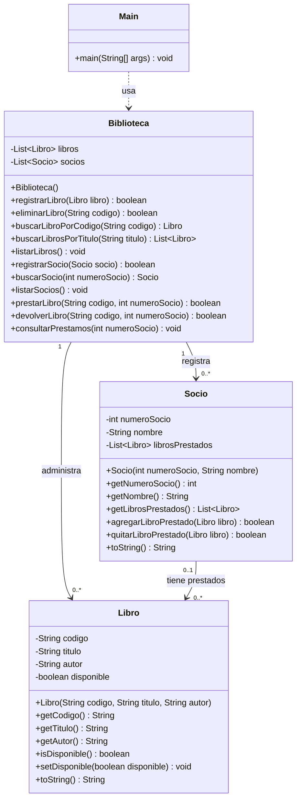

# Diseño inicial del sistema

## 1. Introducción

El sistema de gestión de la biblioteca barrial se desarrollará utilizando Java y programación orientada a objetos.

Se propone organizar el programa mediante clases que representen los elementos principales de una biblioteca: libros, socios y préstamos.

Este diseño es inicial y podrá modificarse durante la etapa de desarrollo.

## 2. Clases principales

### Clase Libro

Representa cada libro registrado en la biblioteca.

Atributos propuestos:
- codigo: identificador del libro.
- titulo: título del libro.
- autor: autor del libro.
- disponible: indica si el libro puede prestarse.

### Clase Socio

Representa a una persona registrada en la biblioteca.

Atributos propuestos:
- numeroSocio: identificador del socio.
- nombre: nombre del socio.
- librosPrestados: lista de libros que tiene actualmente en préstamo.

### Clase Biblioteca

Se encarga de administrar los libros y los socios.

Responsabilidades:
- Registrar y eliminar libros.
- Buscar y listar libros.
- Registrar buscar y listar socios.
- Gestionar préstamos y devoluciones.

Atributos propuestos:
- libros: lista de libros registrados.
- socios: lista de socios registrados.

## 3. Estructuras de datos

Se utilizará `List` y `ArrayList` para almacenar los libros y socios.

Además, cada socio tendrá una lista de libros prestados. De esta manera, se trabajará con listas que contienen otras listas, cumpliendo con el requisito de colección de colecciones.

## 4. Relaciones entre las clases

- Una biblioteca administra varios libros.
- Una biblioteca registra varios socios.
- Un socio puede tener varios libros prestados.
- Un libro solo podrá estar prestado a un socio a la vez.

## 5. Funcionamiento general

El usuario interactuará con el sistema mediante un menú de consola.

Desde ese menú podrá seleccionar las operaciones disponibles para administrar libros, socios y préstamos.

## 6. Consideraciones

Este diseño representa una propuesta inicial. Los atributos, métodos y relaciones definitivos se establecerán durante el desarrollo del proyecto.

## Diseño del menú de consola (Lorenzo Olguin)

El sistema contará con una interfaz de consola organizada en tres secciones principales: gestión de libros, gestión de socios y gestión de préstamos.

### Menú principal

1. Gestión de libros
2. Gestión de socios
3. Gestión de préstamos
0. Salir

### Gestión de libros

1. Registrar libro
2. Buscar libro
3. Listar libros
4. Eliminar libro
0. Volver al menú principal

### Gestión de socios

1. Registrar socio
2. Buscar socio
3. Listar socios
0. Volver al menú principal

### Gestión de préstamos

1. Registrar préstamo
2. Registrar devolución
3. Consultar préstamos de un socio
0. Volver al menú principal

### Funcionamiento del menú

- Cada sección tendrá una opción para regresar al menú principal.
- Después de realizar una operación, el sistema mostrará un mensaje indicando si se realizó correctamente o si ocurrió algún error.
- Una vez mostrado el resultado, el sistema volverá al submenú correspondiente.
- Si el usuario ingresa una opción no válida, se mostrará un mensaje de error y se volverá a presentar el menú correspondiente.
- La opción «Salir» finalizará la ejecución del programa.

## Definición de métodos y responsabilidades (Ramiro Peralta)

Los métodos de cada clase se definen de acuerdo con sus atributos, requerimientos y responsabilidades dentro del sistema.

### Clase Libro

Representa un ejemplar del catálogo y mantiene sus datos y disponibilidad.

- `Libro(String codigo, String titulo, String autor)`
  - Constructor. Asigna el código, título y autor, y establece `disponible = true`.

- `getCodigo(): String`
  - Devuelve el código identificador del libro.

- `getTitulo(): String`
  - Devuelve el título del libro.

- `getAutor(): String`
  - Devuelve el autor del libro.

- `isDisponible(): boolean`
  - Devuelve `true` si el libro está disponible y `false` si está prestado.

- `setDisponible(boolean disponible): void`
  - Actualiza la disponibilidad del libro. Es utilizado por Biblioteca al registrar préstamos y devoluciones.

- `toString(): String`
  - Devuelve una representación textual del libro con su código, título, autor y disponibilidad.

### Clase Socio

Representa a una persona registrada y mantiene la lista de libros que tiene actualmente prestados.

- `Socio(int numeroSocio, String nombre)`
  - Constructor. Asigna el número y nombre del socio e inicializa `librosPrestados` como una lista vacía de tipo `ArrayList<Libro>`.

- `getNumeroSocio(): int`
  - Devuelve el número identificador del socio.

- `getNombre(): String`
  - Devuelve el nombre del socio.

- `getLibrosPrestados(): List<Libro>`
  - Devuelve una copia de la lista de libros que el socio tiene actualmente prestados, evitando que otras clases puedan modificar directamente su lista interna.

- `agregarLibroPrestado(Libro libro): boolean`
  - Agrega el libro a la lista del socio si todavía no figura en ella. Devuelve `true` si se agregó y `false` si ya estaba registrado.

- `quitarLibroPrestado(Libro libro): boolean`
  - Retira el libro de la lista del socio. Devuelve `true` si se quitó y `false` si no figuraba en ella.

- `toString(): String`
  - Devuelve una representación textual del socio con su número identificador y nombre.

### Clase Biblioteca

Administra el catálogo y los socios. Coordina las operaciones y verifica las reglas del sistema.

- `Biblioteca()`
  - Constructor. Inicializa `libros` y `socios` como listas vacías de tipo `ArrayList<Libro>` y `ArrayList<Socio>`.

- `registrarLibro(Libro libro): boolean`
  - Verifica que no exista otro libro con el mismo código. Si el código no está registrado, incorpora el libro al catálogo y devuelve `true`. Si está repetido, devuelve `false` sin modificar el catálogo.

- `eliminarLibro(String codigo): boolean`
  - Busca el libro por su código. Si existe y está disponible, lo elimina y devuelve `true`. Si no existe o está prestado, devuelve `false`.

- `buscarLibroPorCodigo(String codigo): Libro`
  - Devuelve el libro cuyo código coincide con el indicado. Si no encuentra ninguno, devuelve `null`.

- `buscarLibrosPorTitulo(String titulo): List<Libro>`
  - Devuelve una lista con los libros cuyos títulos contienen el texto buscado, sin distinguir entre mayúsculas y minúsculas. Si no hay coincidencias, devuelve una lista vacía.

- `listarLibros(): void`
  - Muestra en consola todos los libros del catálogo con sus datos y disponibilidad. Si el catálogo está vacío, informa que no hay libros registrados.

- `registrarSocio(Socio socio): boolean`
  - Verifica que no exista otro socio con el mismo número. Si no está registrado, lo incorpora y devuelve `true`. Si el número está repetido, devuelve `false`.

- `buscarSocio(int numeroSocio): Socio`
  - Devuelve el socio cuyo número coincide con el indicado. Si no existe, devuelve `null`.

- `listarSocios(): void`
  - Muestra en consola los datos de todos los socios registrados. Si la lista está vacía, informa que no hay socios registrados.

- `prestarLibro(String codigo, int numeroSocio): boolean`
  - Verifica que el libro exista, que el socio esté registrado y que el libro esté disponible. Si se cumplen las condiciones, agrega el libro a la lista de préstamos del socio y establece su disponibilidad en `false`. Devuelve `true` si se registró el préstamo. Si alguna condición falla, devuelve `false` sin modificar los datos.

- `devolverLibro(String codigo, int numeroSocio): boolean`
  - Verifica que el libro y el socio existan, que el libro esté marcado como prestado y que figure en la lista de préstamos de ese socio. Si se cumplen las condiciones, lo retira de la lista del socio y establece su disponibilidad en `true`. Devuelve `true` si se registró la devolución. Si alguna condición falla, devuelve `false` sin modificar los datos.

- `consultarPrestamos(int numeroSocio): void`
  - Busca al socio y muestra los libros que tiene prestados. Si no existe, informa que el socio no está registrado. Si su lista está vacía, informa que no tiene préstamos.

---

### RELACIÓN ENTRE CLASES (Nestor Oviedo)

El diseño del sistema se fundamenta en los principios de la Programación Orientada a Objetos (POO), utilizando relaciones de asociación y dependencia entre clases, basadas en la interacción y administración de objetos.

---

### 1. Relación `Biblioteca` ➔ `Libro` (Asociación 1 a N)

- **Tipo de relación**: Asociación.
- **Descripción**: La clase `Biblioteca` actúa como administrador principal del sistema y posee como atributo una lista `List<Libro> libros` para gestionar el catálogo completo de ejemplares.
- **Multiplicidad**: Una `Biblioteca` puede administrar cero o muchos objetos `Libro`.
- **Justificación**: Representa la premisa *"La biblioteca administra un catálogo de libros"*. `Biblioteca` controla el alta, la baja, la búsqueda y la disponibilidad de los objetos de tipo `Libro`.

---

### 2. Relación `Biblioteca` ➔ `Socio` (Asociación 1 a N)

- **Tipo de relación**: Asociación.
- **Descripción**: La clase `Biblioteca` mantiene el registro general de usuarios a través del atributo `List<Socio> socios`.
- **Multiplicidad**: Una `Biblioteca` puede registrar cero o muchos objetos `Socio`.
- **Justificación**: Responde a la premisa *"La biblioteca tiene socios registrados"*. `Biblioteca` coordina las operaciones globales de préstamos y devoluciones, validando los datos de los socios.

---

### 3. Relación `Socio` ➔ `Libro` (Asociación mediante colección de colecciones)

- **Tipo de relación**: Asociación.
- **Descripción**: Cada objeto de la clase `Socio` mantiene su propia lista privada `List<Libro> librosPrestados`. Al almacenarse los socios dentro de la lista general de la biblioteca, se constituye la **colección de colecciones** del sistema.
- **Multiplicidad**: Un `Socio` puede tener cero o muchos libros prestados. Cada `Libro` puede estar prestado a cero o un solo socio a la vez.
- **Protección de datos**: Para evitar modificaciones no autorizadas desde clases externas, el método `getLibrosPrestados()` retorna una copia defensiva de la lista, mientras que `agregarLibroPrestado()` y `quitarLibroPrestado()` gestionan la asignación y devolución de ejemplares.

---

### 4. Relación `Main` ➔ `Biblioteca` (Dependencia de uso y orquestación)

- **Tipo de relación**: Dependencia.
- **Descripción**: La clase `Main` (que contiene el método de entrada `main`) instancia un objeto `Biblioteca` y orquesta la interfaz del menú de consola, delegando en dicha clase la lógica de negocio.
- **Justificación**: `Main` se encarga de la interacción con el usuario, solicita los datos y muestra los resultados, mientras que `Biblioteca` administra las operaciones y validaciones del sistema.

---

### CRITERIOS PARA EL DIAGRAMA UML

- Las relaciones entre `Biblioteca`, `Libro` y `Socio` se representan mediante líneas de asociación.
- La relación entre `Main` y `Biblioteca` se representa mediante una línea discontinua con una flecha hacia `Biblioteca`, indicando una dependencia.
- Las multiplicidades deben reflejar la cantidad de objetos que pueden participar en cada relación.
- La colección de colecciones se representa mediante la lista de socios de `Biblioteca` y la lista de libros prestados de cada `Socio`.

## Diagrama de clases UML (Francisco Olivera)

El siguiente diagrama representa la estructura del sistema Biblioteca Barrial, incluyendo sus clases, atributos, métodos y relaciones. Se basa en las definiciones y responsabilidades establecidas previamente.

### Consideraciones

- Los atributos son privados y se representan con el signo `-`.
- Los métodos y constructores son públicos y se representan con el signo `+`.
- Las asociaciones muestran cómo se relacionan las clases dentro del sistema.
- La dependencia entre `Main` y `Biblioteca` representa el uso de sus funcionalidades desde el menú de consola.
- La relación entre `Socio` y `Libro` representa la colección de colecciones utilizada para administrar los préstamos.
